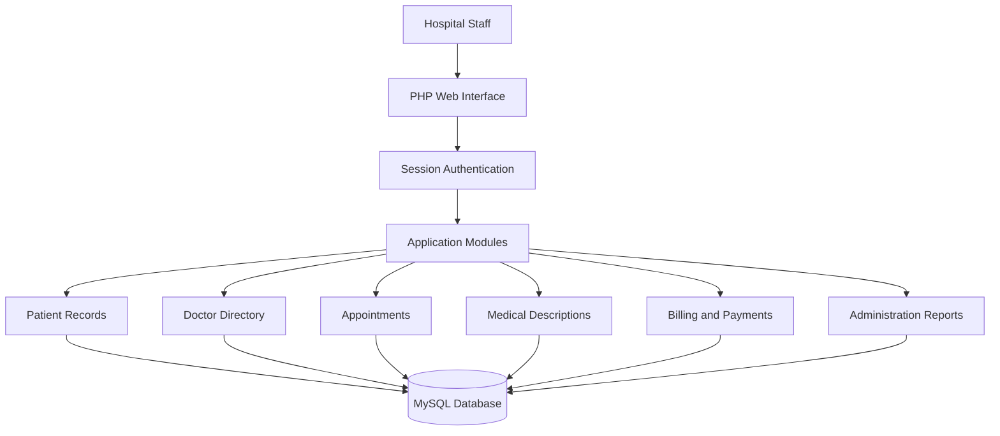

# Online Medical & Hospital Management System

A PHP and MySQL web application demonstrating common hospital administration workflows: patient registration, doctor directory, appointments, medical descriptions/visit notes, billing, payment status, and summary reporting.

> **Portfolio/demo project.** This is a learning application, not a certified Electronic Health Record (EHR), medical device, accounting system, or production-ready hospital platform. Use fictional data only. Do not enter real patient information.

## Implemented modules
- Staff login/logout with password hashing and PHP sessions.
- Dashboard with patient, doctor, appointment, and outstanding-invoice counts.
- Patient registration and patient directory.
- Doctor directory with specialty information.
- Appointment scheduling linking patients and doctors.
- Medical description/visit notes linked to a patient and doctor.
- Invoice creation with service description and amount in INR.
- Mark-pending-invoice-as-paid action.
- Reports showing record counts and paid/pending invoice totals.
- MySQL persistence through PDO prepared statements.
- CSRF tokens on write forms and HTML output escaping.

## Architecture

## Technology
PHP 8.1+, MySQL 8.0+/MariaDB, PDO, HTML5, CSS3.

## Run locally
1. Install PHP 8.1+ with PDO MySQL and MySQL/MariaDB.
2. Import `database/schema.sql` into MySQL.
3. Copy `config/database.example.php` to `config/database.php` and set local credentials.
4. From the project root, run `php -S 127.0.0.1:8000 -t public`.
5. Visit `http://127.0.0.1:8000/setup.php` once to create a demo staff account.
6. Save the generated password, then delete or disable `public/setup.php`.
7. Visit `http://127.0.0.1:8000` and sign in.

## Repository structure
- `app/` — shared database bootstrap, session, CSRF, and layout helpers.
- `config/` — database configuration template.
- `database/` — MySQL schema.
- `docs/` — architecture notes.
- `public/` — login and application modules.
- `tests/` — manual verification checklist.
- `.github/workflows/` — PHP syntax validation workflow.

## Verification
GitHub Actions runs PHP syntax validation and a MySQL-backed HTTP integration suite on pushes and pull requests. The integration suite creates a temporary MySQL database, seeds fictional records, verifies staff login, exercises patient and doctor creation, appointment scheduling, medical-note creation, invoice creation/payment updates, report totals, CSRF rejection, and logout/protected-page behavior. Latest successful checks: [PHP syntax validation](https://github.com/swarajsalve042/online-medical-hospital-management-system/actions/runs/45573712603) and [PHP/MySQL integration tests](https://github.com/swarajsalve042/online-medical-hospital-management-system/actions/runs/45573712623). These are CI test results, not a live deployment or production-readiness claim.

## Security and limitations
- Never commit `config/database.php`, real credentials, or real patient data.
- The demo setup account is for local testing only.
- This project is not intended for real patient records or payment processing.
- Before production use, add role/record-level authorization, audit logs, HTTPS, secret management, encrypted backups, retention controls, dependency review, and independent security/privacy assessment.
- This repository does not claim compliance with any healthcare privacy regulation.

See [SECURITY.md](SECURITY.md), [architecture](docs/architecture.md), [portfolio evidence and screenshot guide](docs/portfolio-evidence.md), and [manual test plan](tests/manual-test-plan.md).
